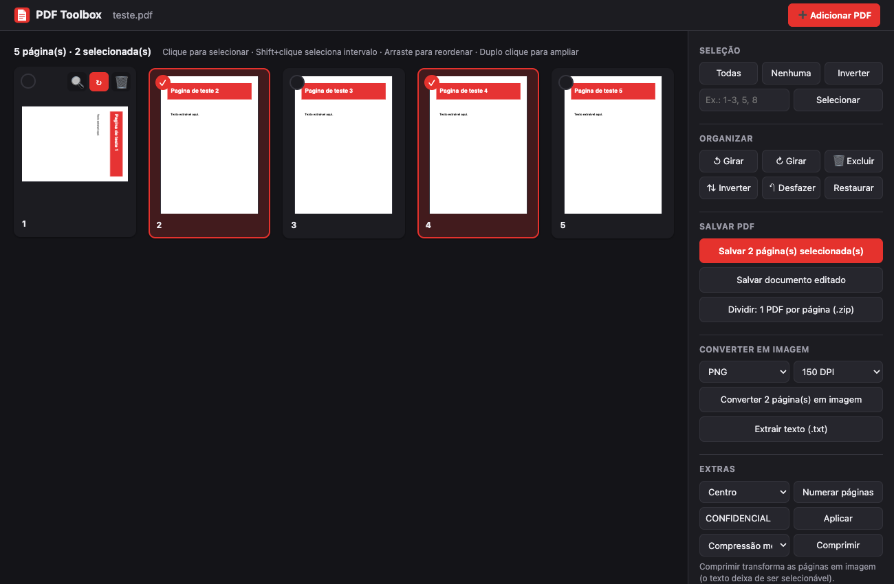
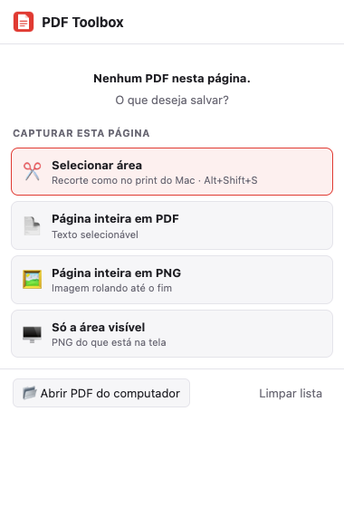
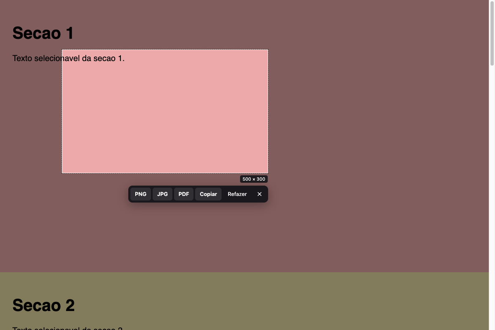

<div align="center">


# PDF Toolbox

**Extensão para Chrome (e navegadores Chromium, como o Comet) que detecta PDFs nas páginas que você visita e permite editar, dividir, converter e capturar, sem enviar nada para servidores.**


</div>

---

Recebeu uma fatura de 9 páginas no e-mail e só precisa de uma? Quer o PDF em imagem para mandar no WhatsApp? Ou quer só recortar um pedaço da página como no print do Mac? O **PDF Toolbox** encontra o PDF sozinho: o ícone pisca e um clique abre um editor completo, no estilo do iLovePDF, só que rodando inteiro no seu navegador.

<p align="center">
  
</p>

## ✨ Funcionalidades

### 🔎 Detecção automática de PDFs
- **Anexos do Gmail**, incluindo os abertos no visualizador
- **Links** para arquivos `.pdf`
- **PDFs embutidos** em `<embed>`, `<object>` e `<iframe>`
- **Respostas de rede** com `Content-Type: application/pdf` (downloads, visualizadores, XHR)
- O ícone **pisca** e mostra quantos PDFs foram encontrados na aba

### 🛠️ Editor de PDF
| Categoria | O que faz |
|---|---|
| **Seleção** | Clique, Shift+clique para intervalo, ou digite `1-3, 5, 8` |
| **Organizar** | Reordenar arrastando, girar, excluir, inverter ordem, desfazer (Ctrl/Cmd+Z), restaurar |
| **Salvar** | Só as páginas selecionadas · documento editado · dividir em 1 PDF por página (.zip) |
| **Juntar** | Adicione outros PDFs pelo botão ou arrastando arquivos para a janela |
| **Converter** | Páginas em **PNG** ou **JPG** (96, 150 ou 300 DPI) · extrair texto (.txt) |
| **Extras** | Numerar páginas · marca d'água · comprimir |
| **Visualizar** | Duplo clique amplia a página; navegue com ← → |

> PDFs **protegidos** (comuns em faturas bancárias) são descriptografados automaticamente antes da edição. Se pedirem senha para abrir, o editor pergunta.

### 📸 Capturar a página (quando não há PDF)


- **✂️ Selecionar área**: arraste um retângulo como no **Cmd+Shift+4** do Mac e salve em **PNG, JPG, PDF** ou **copie** para a área de transferência. Atalho: **⌘ Cmd+Shift+S** (Mac) / **Ctrl+Shift+S** (Windows/Linux)
- **📄 Página inteira em PDF**: a página toda, dividida em folhas A4
- **🖼️ Página inteira em PNG**: uma imagem única, rolando até o fim
- **🖥️ Área visível**: PNG do que está na tela

<br clear="right">

<p align="center">
  
</p>

## 🚀 Instalação

> A extensão ainda não está na Chrome Web Store. A instalação é feita em modo desenvolvedor e leva menos de um minuto.

1. Baixe o projeto:
   ```bash
   git clone https://github.com/guianayans/pdfToolbox.git
   ```
   ou use **Code → Download ZIP** e descompacte.
2. Abra a página de extensões do navegador:
   - Chrome: `chrome://extensions`
   - Comet: `comet://extensions`
   - Edge: `edge://extensions` · Brave: `brave://extensions`
3. Ative o **Modo do desenvolvedor**, no canto superior direito.
4. Clique em **Carregar sem compactação** e selecione a pasta `pdfToolbox`.
5. Fixe o ícone na barra: clique no 🧩 e depois no 📌 ao lado de **PDF Toolbox**.

**Para atualizar:** rode `git pull` (ou baixe de novo), clique em ↻ no card da extensão e recarregue as abas abertas.

## 📖 Como usar

1. Abra um e-mail ou site com um PDF. O ícone da extensão pisca.
2. Clique no ícone. O popup lista os PDFs encontrados.
3. **Ferramentas** abre o editor. **⬇** baixa o original.
4. No editor, selecione as páginas e escolha a ação no painel da direita.

Sem seleção, as ações de converter, dividir, extrair texto e extras valem para **todas** as páginas.

### Atalhos do editor
| Tecla | Ação |
|---|---|
| `Cmd/Ctrl + A` | Selecionar todas |
| `Cmd/Ctrl + Z` | Desfazer |
| `Delete` / `Backspace` | Excluir selecionadas |
| `Esc` | Limpar seleção / fechar visualização |
| `←` `→` | Navegar na visualização ampliada |

## 🔒 Privacidade

- **Todo o processamento é local**, feito no seu navegador. Nenhum arquivo é enviado para servidores.
- Não há analytics, rastreamento nem chamadas para serviços externos.
- A lista de PDFs detectados fica em `chrome.storage.session`, que é apagado quando o navegador fecha.
- Para baixar um anexo (por exemplo, do Gmail), a extensão usa a **sua própria sessão** no site, como se você clicasse em "baixar".

### Permissões e por que são necessárias
| Permissão | Uso |
|---|---|
| `<all_urls>` (host) | Encontrar PDFs em qualquer site e baixá-los com a sua sessão |
| `webRequest` | Identificar respostas de rede que são PDFs (só leitura de cabeçalhos) |
| `webNavigation` | Limpar a lista quando você muda de página |
| `tabs` | Saber qual aba está ativa e abrir o editor |
| `storage` | Guardar a lista de PDFs da sessão |
| `downloads` | Salvar os arquivos gerados |
| `scripting` | Injetar a ferramenta de seleção de área |
| `debugger` | Gerar o PDF/PNG de página inteira com o motor nativo do navegador (só quando você pede) |

## 🧩 Como funciona

```
┌──────────────┐  PDFs no DOM    ┌──────────────────┐  badge + piscar  ┌─────────┐
│  content.js  │ ──────────────► │  background.js   │ ───────────────► │  ícone  │
│ (cada página)│                 │ (service worker) │                  └────┬────┘
└──────┬───────┘                 │  • webRequest    │                       │ clique
       │ busca no contexto       │  • captura       │                  ┌────▼─────┐
       │ da página (fallback)    └────────▲─────────┘                  │ popup    │
       │                                  │ captura / recorte          └────┬─────┘
       │                         ┌────────┴─────────┐                       │
       │                         │   capture.js     │ ◄── Selecionar área ──┤
       │                         │ (overlay injetado)│                       │ Ferramentas
       │                         └──────────────────┘                  ┌────▼─────┐
       └─────────────────────────────────────────────────────────────► │ editor   │
                                                                       │ pdf.js + │
                                                                       │ pdf-lib  │
                                                                       └──────────┘
```

| Arquivo | Papel |
|---|---|
| `manifest.json` | Configuração da extensão (Manifest V3) |
| `background.js` | Detecção via rede, estado por aba, ícone piscando, capturas de página |
| `content.js` | Varre o DOM atrás de PDFs (Gmail, links, embeds) e baixa no contexto da página quando preciso |
| `capture.js` | Overlay de seleção de área (Shadow DOM, sem interferir no site) |
| `popup.*` | Lista de PDFs e opções de captura |
| `editor.*` | Editor: miniaturas, organização e exportações |
| `lib/` | Bibliotecas de terceiros, empacotadas localmente (o MV3 proíbe código remoto) |

## ⚠️ Limitações conhecidas

- **Comet:** o navegador bloqueia a API `debugger` para extensões. Por isso, "página inteira" é feita rolando e capturando a página em partes, e o **PDF sai como imagem** (texto não selecionável). Para PDF com texto, use `Cmd+P → Salvar como PDF`. No Chrome, o PDF é gerado com o motor nativo e mantém o texto.
- **Sites que rolam por dentro de um painel** (o Gmail é um exemplo): "página inteira" captura só a parte visível. Use a seleção de área.
- **Comprimir** transforma as páginas em imagem.
- Páginas internas do navegador (`chrome://`, `comet://`, loja de extensões) não podem ser capturadas.
- Não crie arquivos ou pastas começando com `_` na pasta da extensão: o Chrome recusa carregá-la.

## 🗺️ Ideias para o futuro

- [ ] Assinar e escrever/anotar no PDF
- [ ] Imagens → PDF (JPG/PNG para PDF)
- [ ] OCR para PDFs escaneados
- [ ] Botão flutuante direto no visualizador do Gmail
- [ ] Publicação na Chrome Web Store

## 🙏 Créditos

Bibliotecas incluídas em `lib/`, com suas respectivas licenças:

| Biblioteca | Uso | Licença |
|---|---|---|
| [pdf.js](https://github.com/mozilla/pdf.js) 4.10.38 (Mozilla) | Renderizar páginas, miniaturas, extrair texto | Apache-2.0 |
| [@cantoo/pdf-lib](https://github.com/cantoo-scribe/pdf-lib) 2.11.1 | Montar PDFs, com suporte a PDFs criptografados (fork do [pdf-lib](https://github.com/Hopding/pdf-lib)) | MIT |
| [JSZip](https://github.com/Stuk/jszip) 3.10.1 | Gerar arquivos .zip | MIT / GPLv3 (usado sob MIT) |

## 📄 Licença

Distribuído sob a licença [MIT](LICENSE).
